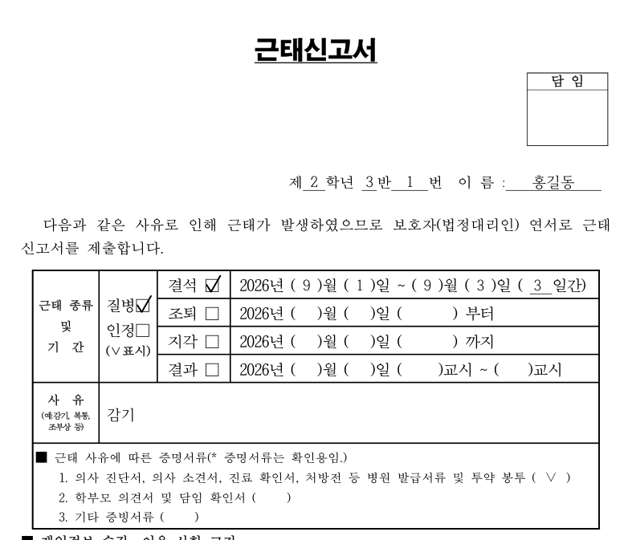

# 근태신고서 자동 작성

나이스에서 내려받은 출결 파일을 불러오면 **근태신고서 PDF의 빈칸을 자동으로 채워** 주는 프로그램입니다.
생리통(출석인정) 건은 **학부모 확인서**도 함께 만들어 줍니다.

## ⬇️ 내려받기

**[최신 버전 내려받기 (Releases)](../../releases/latest)** → `근태신고서_자동작성_v○.○.○.zip` 을 받으세요.

Python 등 다른 프로그램을 설치할 필요가 없습니다.

## 처음 실행하기

1. 받은 ZIP 파일을 **오른쪽 클릭 → [압축 풀기]** 합니다. (ZIP을 연 상태에서 바로 실행하면 동작하지 않습니다.)
2. 압축을 푼 폴더에서 **`근태신고서 자동 작성.exe`** 를 더블클릭합니다.
3. **"Windows의 PC 보호"** 파란 창이 뜨면 **[추가 정보] → [실행]** 을 누릅니다. (학교에서 만든 프로그램이라 Microsoft 서명이 없어서 나오는 안내입니다.)
4. 검은 창이 뜨고 브라우저에 프로그램 화면이 열립니다. **검은 창은 쓰는 동안 닫지 마세요.** 다 쓰면 검은 창을 닫습니다.
5. [1. 기본 설정] 화면의 **[바탕화면에 바로가기 만들기]** 를 한 번 누르면, 다음부터 바탕화면 아이콘으로 실행할 수 있습니다.

자세한 사용법은 ZIP 안의 **`처음 읽어 주세요.html`** 을 열어 보세요.

## 할 수 있는 일

- 일일출석부(.xlsx)·월별 출결 현황(.csv) 불러오기, 같은 출결 중복 자동 정리
- 질병·출석인정 결석/지각/조퇴/결과 신고서 작성 (미인정은 제외)
- 연속 결석은 한 장으로 묶기, 결과·지각·조퇴는 교시로 표기
- 결석·지각·조퇴·결과, 학생, 날짜별로 골라 통합 PDF 또는 학생별 PDF 저장
- 생리통(출석인정) 건은 학부모 확인서 자동 작성 + 증빙서류 표시
- 서명란·날인·담임 확인란은 항상 비워 둠

## 개인정보

- 프로그램은 **이 컴퓨터 안에서만** 돌아가며, 학생 출결 자료를 인터넷으로 보내지 않습니다.
- 입력한 기록과 만든 PDF는 각 컴퓨터의 `%LOCALAPPDATA%\근태신고서` 폴더에만 저장됩니다.
- 새 버전이 있는지 확인할 때만 이 페이지(GitHub)에 접속합니다. 이때 학생 정보는 보내지 않습니다.

## 새 버전

새 버전이 나오면 프로그램 화면 위쪽에 알림이 뜹니다. 새 ZIP을 받아 압축을 풀고 새 폴더의 프로그램을 쓰면 됩니다. **입력한 기록은 그대로 남습니다.**

## 문의

공유된 패들렛 게시물에 댓글로 남겨 주세요. (학생 이름 등 개인정보는 적지 말아 주세요.)
